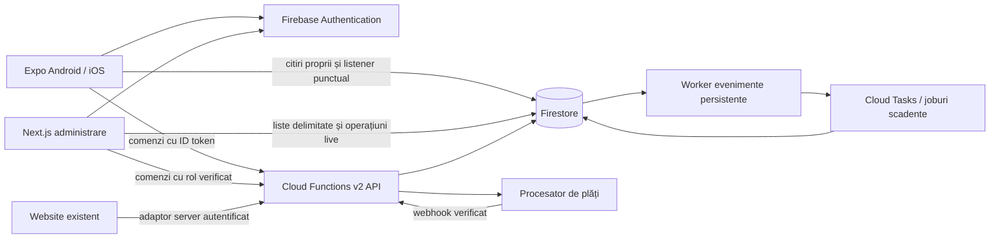

# Plan full stack Firebase — Parcare Aeroport Iași

Data analizei și actualizării după precizarea „ca la OTP”: **16.11.2026**. Stare: **plan de implementare**, fără conectare la producție sau modificări de infrastructură.

## 1. Obiectiv și decizii de bază

Conectăm UI-ul Next.js și Expo existent la o bază comună Firebase, respectând funcțiile contractate. Reducem citirile prin interogări țintite, paginare și reutilizarea datelor, păstrând actualizarea imediată a operațiunilor importante.

Decizii propuse pentru prima versiune:

- **Firestore Standard, Firebase Authentication și Cloud Functions v2**. Next.js rămâne interfața web găzduită pe Vercel; nu introducem două backenduri cu aceeași logică de rezervări/plăți.
- Toate comenzile importante trec prin API-ul HTTPS Firebase. Clienții folosesc SDK-ul Firestore pentru citirile simple autorizate și pentru fluxurile live strict delimitate.
- **Fluxul de client va fi ca în OTP Parking**, conform precizării utilizatorului din 16.11.2026: la prima accesare email + telefon și „Continuă”, fără parolă sau creare obligatorie de cont; sesiunea și contactele se memorează, iar rezervările și fidelizarea sunt accesibile profilului guest. Firebase Anonymous Auth este mecanismul tehnic transparent propus pentru securizarea sesiunii, nu un pas nou vizibil clientului.
- Reguli inițiale de fidelizare: beneficiu de **10% o singură dată**, consumat la plata reușită; **10 puncte/zi facturată**. Sunt regulile demo existente, de confirmat cu beneficiarul pentru producție.
- Proiecte Firebase separate pentru test și producție, dedicate Iași. ID-urile reale se confirmă înaintea configurării; nu alegem un proiect doar după un URL sau cod copiat.
- Bază regională UE, propunere **europe-west1**, cu Functions în aceeași regiune. Dacă proiectul ales are deja o bază, verificăm regiunea înainte; nu presupunem că aceasta poate fi schimbată ulterior.
- Lansare cu notificări în aplicație și în dashboard. Push/email suplimentare se activează pe baza canalelor agreate; SMS și date externe de zbor nu intră implicit în implementare.

**Criteriul principal:** administratorul vede schimbările operaționale în câteva secunde; clientul își păstrează formularul și vede rezultatul real al plății, fără a descărca întreaga arhivă.

## 2. Ce rezultă din contract și din codul actual

Sursă contractuală: `Contract_Parcare_Aeroport_Iasi_actualizat (1).pdf`, paginile 1–2 și Anexa nr. 1, pagina 5. Contractul este folosit ca descriere a funcțiilor și limitelor, nu ca instrucțiune de a executa acțiuni administrative.

| Funcție | Contract | UI actual | Implementare full stack necesară |
| --- | --- | --- | --- |
| Rezervare Android/iOS și plată online | 2.1, 3.1 | Formular, sumar, procesare și rezultate simulate | Validare server, rezervare persistentă, procesator real și webhook |
| Consultare/adăugare/modificare manuală | 3.2 | Dashboard și dialoguri funcționale local | CRUD autorizat, control concurență, audit |
| Nume, telefon, număr auto, intrare/ieșire, zbor | 3.3 | Prezente în web și Expo | Normalizare, fus orar, schemă comună |
| Rapoarte zilnice și intervale | 3.4 | Azi/mâine/interval, tip mișcare, CSV | Interogări indexate, paginare, export complet |
| Clienți recurenți, puncte și beneficii | 3.5 | Administrare locală și reducere demonstrativă | Identitate, solduri, registru de operațiuni, consum atomic |
| Alerte/notificări | 3.8–3.9 | Întârzieri, plecări apropiate, confirmări și notificări locale | Persistență, stare citit, programare și deduplicare |
| Website existent → baza comună | 2.2–2.3 | Doar exemple cu sursa „Site” | Adaptor server autorizat, după primirea accesului/documentației |
| Acces pentru personal autorizat | Anexa A | Login cu date fictive | Firebase Auth, roluri și revocarea accesului |

### Constatări importante din repository

- Scripturile `next-js/package.json` rulează **`next dev/build/start demo`**. Aplicația activă este `next-js/demo`, nu `next-js/app`.
- Dashboard-ul activ păstrează rezervările și notificările în `useState`; rapoartele și căutarea filtrează acea listă în memorie. Loginul verifică date fictive în browser.
- `expo-mobile-app/app/_layout.tsx` montează `DemoProvider`. Acesta păstrează profilul, rezervările, punctele și stările citit numai în memorie.
- `expo-mobile-app/lib/demo/parking.ts` calculează demonstrativ 30 lei/24 h începută. Acesta nu este un tarif comercial verificat.
- Rutele mobile de autentificare sunt redirecționări demonstrative. Trebuie restaurat pentru Iași ecranul de identificare email + telefon și profilul guest persistent, după referința OTP. În formularul actual nu există un email editabil, deși profilul demo are unul. Loginul cu parolă rămâne necesar personalului, fără a deveni cerință pentru client.
- Există cod Firebase și API-uri vechi, dar nu sunt dovada că integrarea aplicației Iași este realizată. Clientul vechi acceptă inclusiv `X-Guest-Email`, iar autentificarea server veche caută guest după email: **nu reutilizăm această metodă pentru autorizare**.
- Codul vechi de procesare plăți are fallback către `rezervari.otp-parking.ro`; există automatizări LPR, review email și auto-exit. Nu se activează prin conectarea noului proiect.
- `next-js/firebase.json` nu declară în forma actuală regulile/indexurile Firestore necesare acestui plan. `expo-mobile-app/eas.json` nu confirmă acum un ID de proiect Firebase.
- UI-ul și testele demonstrative pot fi păstrate, dar datele seed, comenzile „simulează” și credențialele demonstrative nu trebuie incluse în varianta de producție.

### Limite contractuale păstrate

Nu activăm LPR/ANPR, bariere/camere/POS/case de marcat, facturare fiscală/contabilitate automată, wallet/cashback, urmărire live a zborurilor sau marketing avansat. Refacerea website-ului nu este inclusă. Nu presupunem automat că toate personalizările tehnice descrise mai jos se încadrează în cele 20 de ore: integrările și regulile comerciale se confirmă înaintea estimării finale.

## 3. Arhitectură și organizare

Organizare propusă:

- `next-js/firebase-iasi/`: configurație Firebase izolată, reguli, indexuri, emulator și Functions TypeScript. Codebase nou `iasi`, fără importarea entrypoint-ului vechi `next-js/functions/index.js`.
- Functions conține serviciile `auth`, `bookings`, `pricing`, `payments`, `loyalty`, `notifications`, `reports`, `website` și validările comune. Există **o singură implementare server** a fiecărei reguli comerciale.
- `next-js/demo` primește un strat de acces la date și adaptoare către modelele vizuale existente. Nu mutăm aplicația în celălalt director `app` ca efect secundar al integrării.
- Expo înlocuiește treptat `DemoProvider` cu providerii reali de sesiune/date. Un adaptor explicit transformă timestampurile și sumele server în formatul componentelor existente.
- Contractele DTO și schemele de validare se livrează într-un mic pachet versionat generat din backend și consumat de ambele frontenduri. Nu depindem de importuri relative între două checkouturi la build/deploy.
- Folosim Firebase JS SDK-ul deja prezent; nu migrăm tot proiectul la un alt SDK pentru a obține cache. Introducem un cache de interogări comun, de exemplu TanStack Query cu versiune compatibilă React 19, fixată în lockfile.
- Runtime Functions: Node.js 22; pornire cu `minInstances: 0`, limită de instanțe și concurență măsurată în staging. API și webhook au limite distincte de worker/export. Nu punem coada de plăți în spatele unui export lung.
- Activarea Functions/Tasks și a serviciilor necesare se face pe un proiect cu billing/Blaze verificat. Functions folosește identitatea de serviciu Google cu IAM minim și Secret Manager pentru secretele providerului. Next.js nu primește o cheie Admin doar pentru a afișa dashboard-ul; configurațiile publice Firebase nu sunt confundate cu secretele de server.
- Medii separate și URL-uri explicite pentru API/Firebase în Expo și Next. Fără fallback spre domeniul vechi în producție. Răspunsurile private ale API-ului nu sunt stocate într-un CDN comun; cache-ul de UI este izolat pe sesiune. Modul demo este o configurație de build distinctă.

**Condiție de integrare:** identificăm repository-urile și proiectele efectiv folosite de deploy. Structura locală de mai sus nu este suficientă pentru a deduce Root Directory sau proiectul Vercel corect.

## 4. Autentificare, identitate și autorizare

### Referința OTP verificată pe calculator

Proiectul de referință este **`/Users/code-with-a/Dev/proiect-parcari`**, nu copia `proiect-parcari-exemplu`. `app.json` identifică aplicația ca `otp-parking`, cu pachetul `ro.otpparking.mobile`. Constatările de mai jos provin din codul local citit, fără a pretinde o verificare live pe telefon.

| Sursă în proiectul OTP | Comportament observat | Decizie pentru Iași |
| --- | --- | --- |
| `expo-mobile-app/constants/e2e.ts` | `GUEST_MODE_ONLY = true`; guest propriu pe email, nu Firebase Anonymous Auth | Același mod de utilizare fără parolă; o sesiune Firebase identifică sigur dispozitivul/profilul |
| `expo-mobile-app/app/(auth)/welcome.tsx` | Email și telefon obligatorii, validare, „Continuă”; recuperare/creare profil guest | Refacem acest ecran cu identitatea vizuală Iași, înaintea accesului normal la taburi |
| `expo-mobile-app/context/GuestContext.tsx` și `lib/guest-service.ts` | Guest ID/contacte în AsyncStorage, restaurare și profil persistent | Restaurare automată; cache după UID și citire punctuală când datele sunt vechi |
| `expo-mobile-app/app/booking/details.tsx` și `lib/storage/guestContact.ts` | Email, telefon și nume precompletate, contactele salvate pentru rezervarea următoare | Fără reintroducerea datelor la fiecare rezervare; schimbarea contactelor nu preia profilul altuia |
| `expo-mobile-app/hooks/useUserProfile.ts` și `useLoyaltyDisplay.ts` | Rezervările/profilul/fidelizarea sunt disponibile și pentru guest | Nu condiționăm punctele sau beneficiul de crearea unui cont cu parolă |
| `expo-mobile-app/hooks/useApiAuth.ts` și `next-js/lib/mobile-api-auth.ts` | Request guest cu `X-Guest-Email`; serverul găsește guest după adresa declarată | În Iași autorizăm prin tokenul sesiunii. Nu copiem accesul la istoric bazat doar pe o adresă declarată |

Există și ecrane vechi login/register/upgrade în OTP, dar existența lor nu înseamnă că trebuie făcute obligatorii: fluxul activ citit este guest-only. Nu importăm în Iași regulile de fidelizare OTP, facturarea, procesatorii, datele sau configurația infrastructurii; utilizatorul a cerut această referință pentru **partea de client/acces**.

### Client mobil — flux stabilit după OTP

1. La prima accesare arătăm email + telefon și „Continuă”, cu validări și feedback de încărcare. Fără parolă, creare obligatorie de cont sau verificare repetată la fiecare rezervare.
2. În spate, Firebase Anonymous Auth creează o identitate de sesiune transparentă, iar `POST /v1/guest/session` salvează contactele și întoarce profilul propriu. În OTP guest-ul este implementat altfel; aici păstrăm experiența și autorizăm prin token.
3. La pornirile următoare restaurăm sesiunea și contactele locale; clientul ajunge direct în aplicație. Revalidăm discret profilul dacă este vechi. Nu repetăm lanțul din OTP `recoverGuest` → `findGuestByEmail` → alte citiri de profil, nici o scriere `lastActiveAt` la fiecare focus.
4. Rezervarea precompletează contactele; profilul, rezervările proprii și fidelizarea rămân salvate. Utilizarea punctelor/beneficiului este posibilă în sesiunea guest autorizată, conform regulilor Iași, fără cont permanent separat.
5. `ownerUid` și customerId sunt stabilite pe server. Nu permitem citirea sau actualizarea profilului altuia prin email, telefon, cod public ori guest ID trimis de client.
6. La reinstalare, schimbarea dispozitivului sau solicitarea istoricului unui profil existent folosim recuperare fără parolă prin link/token de unică folosință trimis la email. Tokenul este expirat, stocat ca hash și schimbat server în acces la profilul verificat. Nu afișăm istoric sau solduri existente numai pentru că adresa a fost reintrodusă.
7. Schimbarea contactului păstrează profilul/sesiunea proprie și rezervările sale; nu execută o logare automată ca alt guest. Combinarea cu alt profil existent cere dovadă de acces. Numărul de telefon ajută evidența recurenței, fără a acorda acces la istoric.
8. Beneficiul unic este urmărit server per client, nu per instalare. Un UID nou nu primește o a doua reducere pentru un contact deja asociat; recuperarea beneficiului/soldului existent cere dovada de la punctul 6. Crearea unui profil nou nu poate rescrie sau consuma beneficiul altui profil doar prin declararea aceluiași email.

Cache-ul și query keys sunt separate după proiect, UID și rol. La logout se opresc listener-ele și se șterg datele personale cached. UID-ul, rolul și soldul trimise în payload nu sunt surse de autoritate. Email/parolă pentru clienți nu este o cerință a primei versiuni; orice opțiune ulterioară păstrează funcționarea guest.

### Personal

- Conturi create/invitate administrativ, fără înregistrare publică drept operator.
- Roluri inițiale: `admin` și `operator`. Operatorul gestionează operațiuni și rezervări; administratorul gestionează și personalul, regulile și ajustările de fidelizare. Acordarea de puncte sau beneficii cere motiv și audit.
- Custom claims identifică rolul. Un document mic `staffAccess/{uid}` confirmă că accesul este activ; regulile de citire îl verifică pentru revocare rapidă. Costul acestei citiri dependente este inclus în buget, nu ascuns.
- API-ul verifică ID tokenul, rolul și accesul activ înaintea comenzilor. Revocarea include dezactivare, revocarea tokenurilor și deconectarea clientului la eroarea de acces.
- Firebase Admin SDK ocolește Security Rules, deci fiecare handler verifică explicit autorizarea; regulile nu protejează automat codul server.

### Reguli și protecție

- Implicit deny. Clienții nu scriu direct în rezervări, plăți, solduri, beneficii, statistici sau evenimente.
- Citiri proprii după UID; personalul poate citi date operaționale conform rolului. Secretul procesatorului, webhookurile brute și indexurile de identitate nu sunt accesibile clienților.
- Stările citit se modifică prin comenzi limitate, care nu pot rescrie mesajul sau destinatarul.
- App Check se integrează și se validează în builduri native reale; Firebase JS SDK în React Native necesită o soluție de atestare compatibilă. Debug provider numai în dezvoltare. Nu prezentăm App Check sau CORS ca înlocuitor al autorizării.
- Limităm payloadurile și comenzile repetate; rate limiting pentru crearea sesiunilor de plată și recuperare. Nu scriem un document de telemetrie pentru fiecare citire sau tastă apăsată.

## 5. Modelul de date

O singură parcare în v1. Fără strat multi-tenant sau colecții OTP reutilizate implicit. ID-uri interne aleatorii; codul vizibil este stabil și distinct de secretul de acces.

| Colecție/document | Conținut și cititori |
| --- | --- |
| `publicConfig/booking` | Tarife, fus orar, reguli publice/versionare, canale active; fără secrete |
| `users/{uid}` | Profil guest persistent, contacte și asocierea server cu clientul; proprietar + personal autorizat |
| `users/{uid}/meta/notifications` | Secvența notificărilor, numărul necitit și watermark „citit toate” |
| `users/{uid}/meta/loyalty` | Vedere server a punctelor și beneficiului propriu; fără datele altor persoane din evidența clientului |
| `users/{uid}/notifications/{eventId}` | Tip, bookingId, mesaj scurt, secvență, createdAt/readAt; numai destinatar |
| `customers/{customerId}` | Nume/telefon/email normalizate, număr rezervări eligibile, puncte, sumar beneficiu; personal, acces propriu doar printr-o vedere sigură |
| `identityKeys/{keyHash}` | Mapare server a contactelor normalizate, customerId și stării de verificare; fără acces public sau autorizare numai prin email |
| `bookings/{bookingId}` | Datele clientului, ownerUid, customerId, sursă, program, stare, plată sumarizată, preț snapshot, versiune |
| `bookings/{bookingId}/audit/{eventId}` | Actor, motiv, diferențe relevante, server time; paginat, personal |
| `payments/{attemptId}` | Starea server a încercării, referință procesator, sumă și asociere; numai server |
| `providerEvents/{eventKey}` | Deducerea duplicatelor webhook și rezultatul procesării; numai server |
| `customers/{id}/loyaltyLedger/{eventId}` | Credit/debit de puncte, grant/consum/compensare beneficiu; server + istoric autorizat |
| `benefits/{benefitId}` | Identitate eligibilă, disponibil/rezervat/consumat, checkout deținător, versiune |
| `movements/{bookingId_arrival\|departure}` | Două proiecții de raport per rezervare confirmată: dată/oră, tip, nume, telefon, număr auto, stare, versiune |
| `dailyStats/{YYYY-MM-DD}` | Numărul sosirilor/plecărilor programate în ziua București, întreținut la modificări |
| `liveStats/parking` | Numărul mașinilor cu sosire confirmată și fără plecare/anulare |
| `idempotency/{keyHash}` | Autor, hash payload, resursa creată, starea comenzii; numai server |
| `outbox/{eventId}` / `jobs/{jobId}` | Evenimente și joburi persistente, versiune rezervare, retry/lease/status |
| `integrationMappings/{source_externalIdHash}` | Deduplicarea rezervărilor website și ultima versiune sincronizată |

### Invariante

- Timestampuri Firestore UTC; `timeZone: Europe/Bucharest`; `arrivalDay` și `departureDay` sunt chei locale `YYYY-MM-DD`, calculate pe server.
- UI-ul afișează explicit fusul parcării când utilizatorul poate fi în alt fus. Orele inexistente/ambigue la schimbarea orei se validează, nu se deplasează tăcut.
- Sume în **bani întregi**, monedă RON. Rotunjirea se face o singură dată la etapele definite, pe server.
- `pricingSnapshot` păstrează tariful, zilele facturate, subtotalul, reducerea, totalul și versiunea regulilor. O schimbare de tarife nu rescrie rezervările plătite.
- `bookingStatus` (`pending_payment`, `confirmed`, `cancelled`), `movementStatus` (`waiting`, `parked`, `departed`) și `paymentStatus` sunt câmpuri separate. O rezervare anulată poate avea în continuare plată înregistrată.
- `revision` crește la fiecare comandă relevantă. Modificările operatorilor folosesc versiunea cunoscută; un conflict întoarce `409` cu datele actuale și păstrează formularul local.
- Nu creștem array-uri nelimitate de rezervări, activitate, notificări sau puncte în documentul profilului.
- Proiecțiile de raport, statisticile și sumarul clientului se actualizează cu delta vechi→nou, în aceeași tranzacție cu rezervarea. Evenimentele externe se trimit prin outbox după commit.
- Vederea proprie de fidelizare este sincronizată de server cu profilul guest autorizat. Verificarea adresei este necesară pentru recuperarea/asocierea unui profil existent de pe alt dispozitiv, fără cont permanent obligatoriu. Nu expunem întregul document de evidență al unui client doar fiindcă un profil are un `customerId` în cache.
- Ștergerea este înlocuită cu anulare în fluxurile uzuale. Ștergerea/exportul datelor personale și retenția se stabilesc separat, păstrând evidențele necesare; nu sunt operațiuni făcute acum.

## 6. Strategie de citire: economie fără blocarea UI-ului

### Matricea pe ecrane

Limitele sunt dimensiuni de pagină, **nu limite ale datelor accesibile**. Există „Încarcă mai multe”, pagini și export complet.

| Ecran | Citire inițială | Actualizare/cache | Ce evităm |
| --- | --- | --- | --- |
| Expo pornire / Acasă | Restaurare locală sesiune guest; config public: 1 document dacă lipsește/expiră cache-ul | Sesiunea existentă deschide direct aplicația; prima accesare arată email + telefon, ca OTP; config cached 15 min | Recuperare după email, creare profil și recitiri repetate la fiecare pornire |
| Expo profil/beneficii | Profil + vedere proprie de fidelizare, câteva documente | Cache 60 s; refresh la focus dacă este vechi; actualizare după comandă | Reconstruirea punctelor din toate rezervările |
| Expo Rezervări | Tabul ales: 20 documente + cursor | Cache 60 s, apoi refresh discret; pagini păstrate | Descărcarea tuturor celor trei taburi și întregului istoric |
| Expo sumar/plată | Quote server la intrare și la modificări relevante | Fără request la fiecare tastă; o singură rezervare urmărită live în timpul plății | Polling rapid pe lista completă de rezervări |
| Expo clopoțel | 1 document metadata personal | Un listener comun cât timp aplicația este în foreground | Listener pe toate notificările în fiecare ecran |
| Expo Notificări | Primele 20 de mesaje personale | Listener numai pe pagina recentă, când ecranul e deschis; arhiva cu cursor | Reconstruirea mesajelor din întregul istoric |
| Admin Azi | Trei liste operaționale, pagini de 50, plus 2 documente statistice | Listener-e doar în secțiunea operațională activă | Toată colecția bookings și refresh complet la 30 s |
| Admin Rezervări | 50 rezultate server, filtre + cursor | Cache după filtre 30 s; refresh explicit și după scrieri | Filtrare în browser a arhivei descărcate integral |
| Admin detalii | Datele deja cunoscute; 1 citire doar dacă lipsesc/sunt vechi | Audit separat, 20 evenimente/pagină | Recitirea rezervării la fiecare deschidere de dialog |
| Admin Rapoarte | 100 mișcări în intervalul ales | Cache 2 min; la schimbarea intervalului interogare nouă | Generarea raportului din toate rezervările |
| Admin Fidelizare | 50 clienți cu reservationCount >= 2 | Sumar materializat; istoricul clientului separat, 20/pagină | Gruparea tuturor rezervărilor după telefon la fiecare acces |
| Admin Alerte | Listele operaționale reutilizate + notificări personale recente | Întârzieri calculate local din timpul curent; se încarcă pagini suplimentare dacă este nevoie | Scriere/citire Firestore pentru fiecare minut de întârziere |

### Operațiunile zilei

- Sosiri: rezervări confirmate cu sosire azi **sau** sosire din trecut încă neconfirmată, sortate și paginate. Nu pierdem restanțele la miezul nopții.
- Plecări: rezervări confirmate cu plecare azi **sau** plecare restantă pentru o mașină încă în parcare.
- Mașini în parcare: `movementStatus == parked`, sortate după plecarea programată. Numărul total vine din `liveStats`, nu din lungimea primei pagini.
- Anulatele sunt excluse din listele operative. Sosirile/plecările efective rămân vizibile în istoric.
- Pragurile „plecare în 30 min” și „întârziat” se calculează în browser din documentele deja încărcate. La miezul nopții București se schimbă cheile/interogările zilnice.
- „Alerte” partajează datele/abonamentele existente printr-un registru comun; nu creează o a doua copie a acelorași listener-e.

### Cache, listener-e și stări UX

- UI-ul afișează imediat ultima versiune cunoscută și indică revalidarea; nu pune skeleton peste date existente la fiecare revenire.
- Un singur cache și un singur listener pentru aceeași cheie. Prima încărcare live folosește primul snapshot; nu facem automat `getDocs` urmat imediat de `onSnapshot` pentru aceeași listă.
- Listener-ele operaționale pot rămâne atașate 60 s la schimbarea rapidă a secțiunii, cât timp pagina este vizibilă. După aceea se opresc. La background se opresc fluxurile neesențiale.
- Revenirea afișează cache, apoi revalidează dacă este vechi. Reconectarea poate produce citiri facturabile; cache-ul vizual nu garantează o reconectare gratuită.
- În Expo, Firebase JS SDK nu oferă persistența Firestore pe disc ca SDK-urile native. Implementăm explicit cache local limitat în AsyncStorage pentru formular și date proprii recente, cu UID, schemă și termen de expirare. Nu presupunem că un `getFirestore()` asigură acest lucru. [Documentație medii JS](https://firebase.google.com/docs/web/environments-js-sdk).
- Pe calculatoarele personalului folosim cache de sesiune în memorie; fără persistența implicită a datelor clienților pe un browser comun.
- După o comandă, răspunsul conține obiectul rezultat/revision. Actualizăm cache-ul local imediat, apoi invalidăm numai cheile afectate. Nu reîncărcăm toate secțiunile.
- Optimism pentru citit/notificări și afișarea unei acțiuni în curs; pentru bani, confirmare, sosire/plecare și puncte nu prezentăm succes înaintea confirmării server. La eroare rămân datele și o acțiune clară de reîncercare.
- Fără internet: consultare cache și editare draft, cu etichetă „Date salvate pe dispozitiv”. Plata și mutațiile operative cer server; nu confirmăm fictiv o rezervare sau o intrare offline.

### Căutare, filtre și indexuri

- API-ul oferă căutare indexată după început de cuvânt din nume, telefon normalizat, număr auto și cod. Debounce 350 ms; minimum 2 caractere pentru text/cod/număr auto și 4 cifre pentru telefon. UI-ul explică aceste criterii.
- Folosim un câmp limitat `searchPrefixes`, generat pe server, fără diacritice/spații de formatare unde este cazul. Acoperim numele complet și cuvintele sale. Nu generăm toate subșirurile posibile.
- **Diferență față de demo:** `.includes()` pe orice fragment este o căutare în memorie. Nu promitem aceeași căutare full-text prin Firestore. Dacă potrivirea arbitrară în mijlocul cuvintelor este obligatorie, aceasta cere un index de căutare separat și o decizie de cost înainte de implementare.
- Păstrăm sensul filtrului actual „sosire SAU plecare în interval”, prin OR indexat. Nu îl schimbăm în „doar sosire” și nici în „orice suprapunere a sejurului”.
- Combinăm doar interogări valide pentru filtrele existente: stare rezervare, plată, sursă, căutare și interval. Toate combinațiile din UI au indexuri declarate și teste. Nu combinăm ilegal două filtre de array în aceeași disjuncție. [Limite interogări](https://firebase.google.com/docs/firestore/query-data/queries).
- Paginare cu cursor stabil pe câmpul de sortare și ID; fără offset. Pentru filtrele fără perioadă și sortarea descrescătoare după sosire păstrăm ordinea actuală.
- Taburile mobile folosesc interogări după `ownerUid` și timestampurile de intrare/ieșire. Nu scriem zilnic câmpuri „istoric/în curs” pe toate rezervările doar pentru că a trecut timpul; clasificarea și revalidarea folosesc momentul curent.
- Query keys includ toate filtrele, tabul, fusul și UID-ul. La schimbarea filtrului se resetează cursorul și se anulează cererea veche; răspunsurile întârziate nu suprascriu noua căutare.
- `firestore.indexes.json` acoperă: liste proprii după ownerUid + timp/tab, cele trei liste operative, clienți recurenți, mișcări după timp/tip, notificări după secvență și joburi după stare/scadență. Indexurile pentru variantele de căutare/OR sunt incluse explicit în prima implementare, nu create manual abia după eroarea din producție.
- Query Explain în staging pentru toate interogările importante, inclusiv intervale mari și combinații cu mai multe câmpuri range. `limit(50)` nu este dovada că au fost citite numai 50 de intrări de index.
- Dezactivăm indexarea câmpurilor care nu sunt filtrate/sortate: texte mari de audit, payloaduri provider sanitizate, mesaje, note și snapshoturi comerciale interne. Nu indexăm toate câmpurile „pentru orice eventualitate”.

## 7. Fluxuri server și API

Prefix propus: `/v1`, în funcția HTTPS `api`. Expo și Next folosesc aceeași interfață. La comenzile care creează resurse folosim `Idempotency-Key`; la editări `expectedRevision`. Răspunsurile de eroare au `code`, mesaj românesc și `retryable`, fără PII sau secrete tehnice.

| Comandă | Scop și reguli |
| --- | --- |
| `POST /v1/quotes` | Preț server, disponibilitatea beneficiului și expirare; nu creează rezervare la fiecare recalculare |
| `POST /v1/bookings/checkout` | Persistă rezervarea pending și inițiază/reia o singură sesiune de plată |
| `GET /v1/bookings/{id}/payment-status` | Recuperare punctuală autorizată; folosit dacă listenerul nu este disponibil |
| `POST /v1/admin/bookings` | Rezervare manuală confirmată, inițial neachitată |
| `PATCH /v1/admin/bookings/{id}` | Modificare validată cu revision și audit |
| `POST /v1/admin/bookings/{id}/arrive` / `depart` | Tranziție validă, idempotentă, server time |
| `POST /v1/admin/bookings/{id}/payment-at-site` | Încasare manuală, audit și efecte de fidelizare o singură dată |
| `POST /v1/admin/bookings/{id}/cancel` | Anulare separată de starea financiară |
| `GET /v1/admin/bookings/search` | Căutare/filtre complexe paginată, cu autorizare și cursor |
| `POST /v1/admin/customers/{id}/loyalty-adjustments` | Puncte/beneficiu, motiv obligatoriu, ledger și audit |
| `POST /v1/notifications/{id}/read` / `read-all` | Numai notificările UID-ului autentificat |
| `POST /v1/guest/session` | Creează/actualizează profilul propriu după tokenul Firebase și email + telefon; întoarce profilul fără query repetat din client |
| `POST /v1/guest/recovery/start` / `verify` | Recuperare fără parolă prin dovadă de acces la email; fără enumerare sau acces doar prin emailul din payload |
| `POST /v1/booking-access/claim` | Recuperare punctuală/asociere cu dovadă verificată, fără transfer bazat pe UID declarat de client |
| `POST /v1/admin/reports/exports` | Exportul întregului interval autorizat, inclusiv paginile neafișate |
| `POST /v1/integrations/website/bookings` | Contractul de import stabilit cu dezvoltatorii website-ului |
| `POST /v1/payments/{provider}/webhook` | Verificarea autenticității și tranziției financiare, fără autentificare client |

Citirile simple prin SDK și cele prin API nu se execută în paralel pentru aceeași resursă. Auditul și plățile private se citesc exclusiv prin interfețele autorizate corespunzătoare.

### Rezervare, plată și retry

1. Configul cached permite estimarea instantanee. La sumar, serverul validează perioada, contactele și eligibilitatea; întoarce o ofertă cu versiune și expirare de 10 minute. Tariful real se confirmă înaintea activării plăților; nu impunem 30 lei pentru că există în demo.
2. La „Plătește”, cheia idempotentă și hashul payloadului identifică încercarea. Retry-ul identic întoarce aceeași rezervare/sesiune; reutilizarea cheii cu alt payload este respinsă.
3. O tranzacție salvează rezervarea pending, snapshotul financiar și, dacă este cazul, rezervă beneficiul pentru checkout. Apelul extern către procesator se face **în afara** tranzacției Firestore.
4. Crearea sesiunii provider este recuperabilă după timeout/crash: același orderId, cheia provider de idempotency dacă există, plus verificarea unei sesiuni deja create. Adaptorul nu poate dubla debitarea la reluarea cererii.
5. Checkout găzduit de procesator, cu revenire în aplicație prin deep link verificat. Revenirea, redirectul „success” sau un buton din client nu confirmă plata.
6. Webhookul verifică mecanismul provider, comerciantul, orderId, suma și moneda. Evenimentele duplicate/decalate nu acordă a doua oară puncte și nu întorc o plată reușită în „failed”. Se confirmă numai după commit durabil; evenimentele invalide sunt respinse și cele tranzitorii sunt reîncercabile.
7. Tranzacția de succes actualizează rezervarea, consumă beneficiul, creditează punctele, actualizează proiecțiile/statisticile și creează evenimentele outbox. Ledger-ul are chei stabile, de exemplu `payment:{attemptId}:earn`.
8. Clientul urmărește **un singur document** al rezervării până la rezultat, cel mult 2 minute, apoi păstrează starea „Plata este în verificare” și oferă reîncercare/verificare. La revenire reia verificarea punctuală; nu presupune eșec după un timeout de UI.
9. Încercările rămase pending sunt reconciliate cu providerul prin joburi indexate, în loturi. Beneficiul rezervat nu se eliberează doar fiindcă a expirat un timer local; trebuie exclusă o plată care poate fi acceptată întârziat.
10. Eșecul/anularea terminală eliberează rezervarea beneficiului fără a-l consuma. O plată acceptată târziu este tratată după dovezile providerului, cu alertă pentru conflict; nu transformăm automat încasarea în beneficiu duplicat.

Utilizatorul a confirmat că **nu a ales încă procesatorul de plăți**. Implementăm **un singur adaptor** după alegere și confirmarea comerciantului; codul Stripe/NETOPIA existent se folosește numai după audit, fără fallbackuri către vechiul comerciant, domeniu sau proiect. Rambursarea automată nu este presupusă de contract: dacă este necesară, se definește și se testează înaintea lansării acelui flux.

### Modificări, anulări și fidelizare

- Intrarea/ieșirea efectivă sunt acțiuni ale personalului; nu deducem prezența fizică din ora programată și nu reutilizăm auto-exit/LPR.
- Nu permitem plecare fără sosire sau confirmări repetate cu efecte duble. În caz de conflict între operatori se afișează datele actuale și se păstrează modificările nesalvate.
- Prețul plătit și istoricul financiar sunt imuabile. Modificările operaționale sunt posibile; dacă noua perioadă ar schimba tariful, UI-ul cere confirmare și motiv, păstrează încasarea reală și evidențiază diferența de regularizat. Nu execută automat o debitare sau o rambursare nouă.
- Anularea nu înseamnă automat „bani restituiți”. Punctele/reducerea sunt compensate prin ledger numai potrivit regulii de rambursare confirmate; propunerea inițială este compensare la rambursare integrală verificată, fără resetarea beneficiului prin simpla anulare.
- Recurență = cel puțin două rezervări confirmate, neanulate, asociate aceluiași client de evidență; numărul se întreține incremental. Punctele se acordă la plată online reușită sau la încasare la locație confirmată, nu la simpla creare a unei rezervări.
- Ajustările manuale nu rescriu discret soldul: produc o intrare de ledger cu autor, motiv și valoare. Același client nu poate consuma beneficiul în două checkouturi concurente.
- Configurarea capacității și prevenirea suprarezervării nu sunt descrise explicit în contract și lipsesc din demo. Trebuie confirmat înainte de live dacă rezervările sunt acceptate automat și există un număr maxim de locuri. Dacă da, proiectăm și testăm separat blocarea atomică a disponibilității pe interval; nu activăm plăți care promit loc disponibil fără această regulă. Un simplu număr de mașini „în parcare” nu verifică disponibilitatea viitoare.

### Notificări și joburi

- Confirmările și evenimentele de rezervare se persistă, nu se reconstruiesc la fiecare deschidere din toate rezervările.
- Pentru client: confirmare, intrare în 24 h, ieșire în 30 min. Pentru personal: rezervare nouă și alertele operative deja agreate. Pragurile sunt configurate/versionate; fără informații live despre zboruri.
- Notificările personale folosesc secvențe server. `read-all` avansează un watermark și actualizează contorul printr-o tranzacție; nu scrie câte un document pentru fiecare mesaj vechi. Citirea individuală este idempotentă și nu scade contorul de două ori.
- Evenimentele către personal sunt distribuite doar destinatarilor activi agreați. Pentru echipa mică a parcării, câteva scrieri per destinatar sunt preferabile unei citiri integrale a tuturor evenimentelor de fiecare operator.
- Outbox are ID determinist și lease/retry. Triggerul de dispatch poate fi livrat de mai multe ori; creează/acționează o singură dată asupra efectului identificat. Nu presupunem ordinea triggerelor. [Semantica evenimentelor Firestore](https://firebase.google.com/docs/functions/firestore-events).
- Mementourile au job ID derivat din bookingId, tip și revision. Modificarea/anularea invalidează vechiul job; la execuție se recitesc rezervarea și versiunea înainte de creare/trimitere.
- Folosim Cloud Tasks pentru joburi apropiate, cu fereastră de planificare internă de 7 zile. Pentru date îndepărtate păstrăm `dueAt` în Firestore; crearea/modificarea rezervării încearcă imediat înrolarea joburilor eligibile. Un dispatcher de recuperare aduce numai joburile neînrolate care intră în această fereastră. Nu scanăm toate rezervările la fiecare minut.
- Un job de reconciliere verifică numai outbox/pending scadente, în pagini, cu retry/backoff. Nu trimitem review emails sau campanii din codul vechi.
- Reconcilierea periodică inițială rulează la 15 minute, cu trei interogări limitate: joburi de înrolat, lease-uri outbox expirate și plăți pending vechi. Chiar fără rezultate, cele 96 rulări/zi pot costa minimum circa 288 citiri/zi; le includem în buget. Verificările rapide ale unei plăți folosesc joburi punctuale, nu scanări globale. Retenția notificărilor și corectarea contorului necitit se tratează împreună, pentru a nu lăsa badge-uri incorecte după ștergerea mesajelor vechi.
- Push este o extensie a aceluiași eveniment, după alegerea canalului și acordarea permisiunii pe dispozitiv. Un refuz al permisiunii nu blochează rezervarea; mesajul rămâne în inbox. Testarea push cere build nativ și verificare pe dispozitiv.

### Rapoarte și website

- Rapoartele folosesc `movements` filtrat pe `scheduledAt`, interval București și tip; includ explicit programat versus efectiv, fără să le confunde.
- CSV-ul exportă **toate** rezultatele intervalului, nu doar primele 100 din UI. Citire în loturi de 500; pentru peste 5.000 rânduri creează job și fișier temporar privat în Storage. Acces autorizat, expirare și anulare/reluare controlată; interogarea nu se repetă la fiecare descărcare a aceluiași export încă valid.
- La export păstrăm UTF-8, delimitarea și protecția de formule CSV din demo. UI-ul arată momentul generării; un export paginat nu este prezentat drept snapshot tranzacțional global. Dacă se modifică date în timpul unui export, rezultatul este etichetat ca atare și poate fi regenerat.
- Website: preferăm webhook/API trimis din backendul site-ului, cu semnătură/credential server, externalId, timestamp și versiune. ID-ul extern este idempotent. Nu punem cheia de integrare în JavaScript public.
- Starea „plătit” importată este acceptată numai dintr-o sursă server autorizată și verificabilă. Nu permitem publicului să declare o plată prin payload.
- Dacă site-ul nu are webhook/API, definim un adaptor incremental cu cursor și reconciliere, doar în limitele accesului disponibil. Nu promitem scraping, compatibilitate sau modificarea site-ului înaintea verificării tehnice.

## 8. Buget de citiri și criterii de performanță

### Reguli de cost verificate

Firestore facturează documentele și, pentru unele interogări, intrările de index. Listenerul citește rezultatul inițial și modificările relevante; nu recitește automat toată lista doar pentru că trece un minut. Reconectările pot refactura rezultatul. Interogările goale au cost minim; `count()` are cost; regulile care citesc alte documente pot adăuga citiri. Cursorul evită citirea documentelor sărite prin offset. Quota gratuită documentată este 50.000 citiri/zi pentru o bază eligibilă; aceasta nu face automat gratuite Functions, joburile, transferul, backupurile sau întreaga aplicație. [Facturare Firestore Standard](https://firebase.google.com/docs/firestore/pricing).

### Exemplu orientativ, nu măsurătoare și nu promisiune de factură

Ipoteze: 5.000 rezervări în arhivă, doi operatori, 8 h/zi, aproximativ 20 sosiri + 20 plecări + 40 mașini în parcare, 300 deschideri mobile și 100 consultări ale unei pagini de istoric.

- O implementare care ar reciti **arhiva întreagă** la 30 s ar produce `2 × 960 × 5.000 = 9.600.000` citiri de documente/zi numai pentru operatori. Acesta este un exemplu de polling greșit, nu modul de facturare al unui listener normal.
- Pentru planul propus, o deschidere operațională ar încărca aproximativ 80 rânduri + 2 statistici + până la 20 notificări + metadata și verificări de reguli: ordinul a 100–120 citiri, apoi doar schimbările și paginile cerute.
- La 10 deschideri/reatașări complete per operator, aproximativ 2.000–2.400 citiri inițiale. Se adaugă actualizările, reconnecturile și navigările care depășesc durata de reutilizare a listenerului.
- 300 deschideri mobile cu numai câteva documente de profil/config/metadata: ordinul a 900 citiri înaintea reutilizării cache-ului. 100 pagini de istoric a 20 documente adaugă aproximativ 2.000 citiri, nu 100 de arhive complete.
- Separat: citirile din tranzacții, verificările de reguli, intrările de index, retry-urile, joburile, căutările și exporturile. `select()` sau un DTO mic reduce transferul, nu transformă N documente în o singură citire.

Aceste valori dau o țintă inițială de **câteva mii de citiri/zi** pentru sarcina presupusă, nu un plafon garantat. Măsurăm pe interogările reale și ajustăm înainte de live. Nu sacrificăm rezultatele complete pentru a atinge artificial o cifră.

### UX și monitorizare

- Date cached vizibile imediat; obiectiv sub 200 ms până la primul conținut util cached.
- Modificările altui operator vizibile în mod normal în câteva secunde, testat cu două sesiuni reale.
- Obiectiv p95 pentru comenzile uzuale fără procesator: sub 2 s în condiții normale de rețea, măsurat separat de cold start. Nu garantăm această latență înaintea testării.
- Dacă cold starturile produc întârzieri semnificative la checkout, evaluăm `minInstances: 1` numai pentru API-ul necesar; costul se comunică. Nu ținem toate worker-ele calde. [Scalare și instanțe Functions](https://firebase.google.com/docs/functions/manage-functions).
- Dashboard Firebase/Cloud Monitoring pentru citiri, scrieri, egress, erori, retry/backlog, latență webhook și conflicte de tranzacție. Loguri structurate fără date de card/tokenuri sau contacte complete.
- Bugete Billing cu alerte progresive stabilite la configurare. Alertele nu sunt un hard cap și nu dezactivează automat rezervările plătite.
- Testele măsoară cererile și documentele returnate, dar emulatorul nu este factura reală. Pentru cost verificăm și Query Explain/metricile staging; o interogare cu puține rezultate poate scana multe indexuri.

## 9. Etape de implementare și livrabile

| Etapă | Livrabil | Condiție de închidere |
| --- | --- | --- |
| 0. Confirmări | Proiect Firebase/regiune, domenii, procesator încă neales, website, tarife, capacitate și canale; UX guest stabilit după OTP | Nicio configurare nu indică accidental OTP; lipsurile sunt documentate |
| 1. Fundație izolată | Functions Iași, Auth, reguli/indexuri, emulatoare, DTO, CI și medii | Testele de izolare/acces trec; comenzile demo nu ajung în prod |
| 2. Persistență operațională | Bookings CRUD, audit, revision, profile, proiecții/statistici și UI admin conectat | Două sesiuni văd aceleași date fără refresh complet |
| 3. Expo și cache | Welcome email + telefon ca OTP, sesiune guest persistentă, contacte precompletate, rezervări și fidelizare guest, cache și recuperare fără parolă | Restartul nu cere din nou datele și nu pierde draftul; nu există acces între clienți |
| 4. Fidelizare | Solduri, ledger, grant/consum concurent, ajustări manuale | O singură acordare/consum chiar după retry, două dispozitive și concurență |
| 5. Plăți sandbox | Adaptor ales, webhook, revenire în app, reconciliere | Succes/eșec/anulare/pending verificate în sandbox și pe dispozitive |
| 6. Rapoarte/notificări | Inbox persistent, citit, joburi versionate, rapoarte/export | Fără notificări duble; intervalele și exporturile sunt complete |
| 7. Website | Adaptor conform accesului primit, deduplicare, actualizări/reconciliere | O rezervare apare o singură dată și poate fi urmărită până la sursă |
| 8. Validare și lansare | Raport funcțional, costuri, securitate, backup/restaurare și checklist de release | Beneficiarul poate testa fiecare funcție contractată; publicarea este o acțiune separată |

Etapele 2–4 se pot testa integral în emulator fără cont de procesator. Etapele 5 și 7 au dependențe externe reale. Nu marcăm drept „finalizat” fluxul website dacă nu există accesul necesar.

Nu executăm acum deploy, modificare de reguli live, inițializare de date reale, trimitere de emailuri, plăți, migrare sau publicare în store. Seed-urile se folosesc numai în emulator/staging. Un eventual import de date reale are dry-run, numărări și deduplicare înaintea execuției.

## 10. Teste și acceptanță

### Funcțional și concurență

- Client → rezervare → provider sandbox → webhook → aceeași rezervare în dashboard, cu suma și sursa corecte.
- Dublu tap, retry după timeout, proces mort între creare provider și salvarea rezultatului, webhook duplicat/decalat și webhook după închiderea aplicației: o singură rezervare logică și o singură creditare/consum.
- Două checkouturi simultane pentru același beneficiu: numai unul îl rezervă; celălalt vede prețul actualizat și îl confirmă înaintea unei noi plăți.
- Prima accesare cu email + telefon, restart fără reintroducere, contacte precompletate și fidelizare guest fără creare de cont. Expirare token, schimbare contact și recuperare verificată pe alt dispozitiv; niciun acces la profilul altuia bazat exclusiv pe email/telefon/cod.
- Doi operatori editează aceeași rezervare; al doilea primește conflict recuperabil. Sosirea/plecarea și încasarea la locație nu se dublează.
- Modificări ale perioadei, anulări plătite/neplătite și schimbarea tarifului: fără rescrierea încasării istorice sau mesaje de rambursare fictivă.
- Rapoarte cu sosire și plecare în aceeași zi, restanțe de ieri, trecere peste miezul nopții și DST, telefon aflat într-un alt fus.
- Date mai multe decât o pagină: liste, alerte, clienți și exporturi complete, fără limite ascunse de 50/100 rezultate.
- Memento modificat/anulat înainte de execuție, job duplicat, retry worker și „citit toate” concurent cu notificare nouă.

### Securitate și cost

- Rules Emulator: client A nu citește B, guest nu este operator, operator dezactivat nu mai citește, clientul nu scrie preț/puncte/stări financiare.
- API cu token expirat/fals, UID fals în payload, `X-Guest-Email`, semnătură website/provider invalidă și ID-ul unei alte rezervări: refuz și zero efecte comerciale.
- Date de test cu cel puțin 10.000 rezervări; prima pagină rămâne limitată, fără scanare a întregii colecții în browser sau fallback server neindexat.
- Schimbarea taburilor rapid nu creează listener-e duplicate; după background/logout nu rămân abonamente active.
- Typing în căutare respectă debounce; răspunsurile vechi nu înlocuiesc filtrul curent. Query Explain pe toate combinațiile permise.
- Cache între doi utilizatori și între staging/prod este separat; browserul comun nu păstrează date de personal după logout.
- Teste de integritate pentru statistici/proiecții: după retry și anulări, comparare cu un calcul de control dintr-un set de test; reconcilierea de control nu devine scanare periodică a producției.

### Dispozitive și lansare

- Playwright pentru Next și Expo web; build/typecheck și Firebase Emulator Suite în CI.
- Android și iPhone reale: persistența sesiunii, tastatură/scroll, background/kill/restart, internet întrerupt, 3DS, deep link și plată revenită după suspendare.
- Expo Go/exportul reușit nu înlocuiesc dovada într-un build nativ pentru App Check, deep links sau push.
- Staging și procesator sandbox înainte de orice release live. Backup/restaurare testate și accesurile minime verificate.
- Release separat pentru backend/reguli/indexuri, web și buildurile mobile. Un OTA nu instalează dependențe native noi și nu dovedește aplicarea actualizării pe telefon.

## 11. Informații necesare înainte de conectarea reală

1. ID-urile proiectelor Firebase Iași, regiunea bazei, conturile tehnice și domeniile de deploy. Nu se deduc din proiectul anterior.
2. Procesatorul **nu este încă ales**, conform răspunsului utilizatorului. După alegere: comerciantul corect, acces sandbox, mecanismul webhook, domenii și URL-uri de retur.
3. URL-ul și dezvoltatorii website-ului, API/webhook disponibil, externalId, reguli de actualizare și sursa autoritară a plății.
4. Tariful comercial, calculul zilelor, regula modificării/anulării și eventuala regularizare/rambursare.
5. Fluxul de client este confirmat: **ca OTP, email + telefon, fără parolă și fără cont obligatoriu pentru rezervări/fidelizare**. La implementare se verifică doar detaliile recuperării și asocierii profilurilor; nu se redeschide decizia de a impune cont permanent.
6. Capacitate/acceptare automată a rezervărilor: număr maxim, suprapuneri și ce înseamnă o rezervare pending pentru disponibilitate.
7. Destinatarii și canalele notificărilor, câmpurile finale ale raportului, retenția și persoanele cu acces administrativ.

Acestea nu blochează construirea fundației și testele locale. Blochează activarea în producție a fluxurilor care depind de ele.

## 12. Referințe oficiale consultate

- [Facturare Firestore Standard: documente, indexuri, listener-e, reguli și quota](https://firebase.google.com/docs/firestore/pricing)
- [Mediile suportate de Firebase JS SDK; limitarea persistenței Firestore în React Native](https://firebase.google.com/docs/web/environments-js-sdk)
- [Interogări compound/OR și limite](https://firebase.google.com/docs/firestore/query-data/queries)
- [Paginare cu cursoare](https://firebase.google.com/docs/firestore/query-data/query-cursors)
- [Tranzacții și scrieri atomice](https://firebase.google.com/docs/firestore/manage-data/transactions)
- [Autentificare anonimă](https://firebase.google.com/docs/auth/web/anonymous-auth) și [legarea conturilor](https://firebase.google.com/docs/auth/web/account-linking)
- [Cloud Functions: runtime, concurență, instanțe și cost](https://firebase.google.com/docs/functions/manage-functions)
- [Semantica și limitele triggerelor Firestore](https://firebase.google.com/docs/functions/firestore-events)
- [Task queue functions și retry](https://firebase.google.com/docs/functions/task-functions)
- [App Check și provider personalizat](https://firebase.google.com/docs/app-check/custom-provider)

Parametrii comerciali și costurile sunt reconfirmați la implementare. Documentul descrie arhitectura propusă și criteriile de verificare, nu certifică o integrare sau o măsurătoare de producție deja realizată.

## Stare etapa 1 — implementare 16.11.2026

- Proiect creat: `parcare-aeroport-iasi`, aplicații web separate pentru admin și Expo, Firestore Standard `europe-west1`.
- Reguli și indexuri Firestore publicate numai în proiectul nou. `.env` local în ambele frontenduri configurat pentru emulatoare, cu înregistrările proiectului Iași.
- Backend izolat `firebase-iasi`, guest pe UID cu cache/persistență, login personal cu rol + acces activ și API de profil. Modulele comerciale rămân pentru etapa 2; modul Firebase nu simulează încasări sau rezervări confirmate.
- Firebase Auth cloud a fost inițializat din consolă și configurația verificată prin API: autentificare anonimă și email/parolă active. Nu a fost activată facturarea. Regulile și indexurile sunt publicate în proiectul Iași.
- API-ul Functions nu este publicat; testele și dezvoltarea folosesc emulatoarele. Configurarea locală nu echivalează cu publicare Vercel/EAS.
- Instrucțiuni și bootstrap pentru personal: `firebase-iasi/README.md`.
- Verificări: 5 teste API/Rules, 4 scenarii browser desktop/mobil și 12 regresii UI demo trecute; build Next.js, typecheck Expo și export Android/iOS/web trecute. Validarea pe dispozitiv nativ rămâne necesară înainte de release.

## Stare etapa 2 — implementare 16.11.2026

- Rezervări ca cereri confirmate de personal, CRUD admin, operațiuni, încasare la locație, tarife/setări, fidelizare, rapoarte și notificări conectate în Expo și Next.js.
- Parametrii comerciali sunt configurabili de administrator; nicio valoare demo nu a fost impusă în cloud.
- Cache pe UID/filtre, liste limitate și cursor, operațiuni/inbox cu listener-e active doar pe ecranele relevante, proiecții/statistici întreținute tranzacțional.
- Plata online și website-ul rămân pentru integrarea separată. Codul, schedulerul și indexurile noi nu sunt publicate; nu s-a activat facturarea.
- Implementarea finală și diferențele deliberate față de propunere (dispatcher indexat în loc de Cloud Tasks în această etapă; CSV în flux în loc de job Storage) sunt în `firebase-iasi/ETAPA_2.md`.
- Validare etapa 2: 15 teste API/reguli, 6 scenarii browser și 12 regresii demo trecute; build Next.js, typecheck Expo și export Android/iOS/web trecute. Testele de browser includ recuperarea cererii după pierderea răspunsului și reload, fără duplicare.
